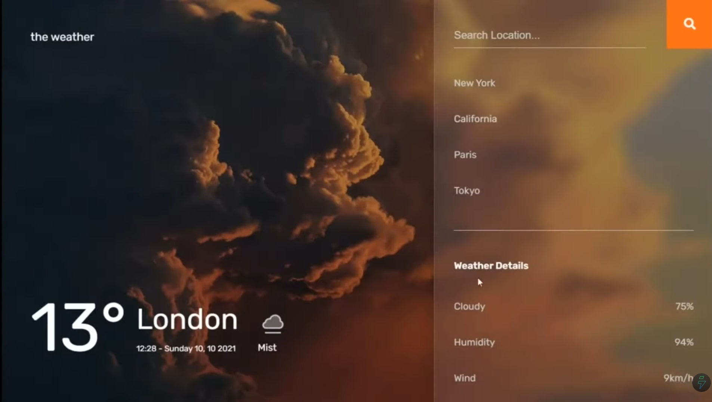

<div align="center">

# Weather Forecasting Website
### Real-Time Meteorological Telemetry, Geolocation Intelligence & Multi-Day Atmospheric Analytics

[](https://developer.mozilla.org/en-US/docs/Web/JavaScript)
[](https://openweathermap.org/)
[](https://developer.mozilla.org/en-US/docs/Web/HTML)
[](https://developer.mozilla.org/en-US/docs/Web/CSS)
[](LICENSE)

<p align="center">
  <b>A responsive meteorological web application delivering real-time atmospheric telemetry and multi-day predictive forecasts for any global coordinate.</b><br>
  Built with asynchronous RESTful API consumption, HTML5 Geolocation coordinates, dynamic DOM state rendering, and resilient input sanitization.
</p>

---

</div>

## Executive Summary

Accessing accurate, hyper-local meteorological data requires seamless integration between browser-level hardware telemetry (Geolocation APIs) and external cloud endpoints.

**Weather Forecasting Website** provides a streamlined, zero-friction atmospheric dashboard. The engine enables users to either search global coordinates via city/state queries or invoke automatic one-click GPS coordinate resolution. Inbound JSON payloads from OpenWeatherMap are parsed in-memory and translated into high-clarity telemetry cards detailing ambient temperatures, humidity coefficients, atmospheric pressures, wind vectors, and multi-day forecast trajectories.

---

## 🎥 Interactive Video Walkthrough & UI Showcase

<div align="center">

<video src="https://github.com/vsbeginner/Weather-Forecasting-Website/raw/main/Demo%20(2).mp4" controls="controls" width="100%"></video>

<sub><b>Interactive Walkthrough:</b> Live interactive weather forecasting demonstration, geolocation detection, and OpenWeatherMap API telemetry.</sub>

<br><br>

<br>
<sub><b>Visual Dashboard:</b> Real-time meteorological telemetry, humidity, wind speed, and multi-day forecast.</sub>

</div>

---

## Architectural Taxonomy & Asynchronous Flow

```
┌────────────────────────────────────────────────────────────────────────────────────────┐
│                                CLIENT VIEWPORT & USER INPUT                            │
└────────────────────────────────────────────────────────────────────────────────────────┘
                    │                                            │
        (Manual City Search Query)                  (GPS Geolocation Prompt)
                    │                                            │
                    ▼                                            ▼
       ┌────────────────────────┐                   ┌────────────────────────┐
       │ Input Sanitizer Guard  │                   │ Geolocation API Worker │
       └────────────────────────┘                   └────────────────────────┘
                    │                                            │
                    └─────────────────────┬──────────────────────┘
                                          │
                                          ▼
                             ┌─────────────────────────┐
                             │  Async Fetch Controller │
                             │  (OpenWeatherMap API)   │
                             └─────────────────────────┘
                                          │
                         ┌────────────────┴────────────────┐
                         ▼                                 ▼
             ┌───────────────────────┐         ┌───────────────────────┐
             │ 200 OK: JSON Payload  │         │ 404 / Error Catch     │
             │ Parse Temperature,    │         │ Modal Notification    │
             │ Wind, Humidity & Icons│         │ & Recovery Guidance   │
             └───────────────────────┘         └───────────────────────┘
                         │
                         ▼
             ┌───────────────────────┐
             │ Reactive DOM Renderer │
             │ (Dynamic Cards & HUD) │
             └───────────────────────┘
```

---

## Core Technical Features

| Feature Module | Technical Implementation | Practical User Benefit |
|:---|:---|:---|
| **Global City Search** | URL-encoded asynchronous fetch requests query OpenWeatherMap endpoints. | Instant weather discovery across any global municipality. |
| **One-Click Geolocation** | Native `navigator.geolocation.getCurrentPosition()` coordinates resolution. | Zero-typing automatic weather report for the user's current location. |
| **Multi-Day Trajectory** | Array parsing of forecast timestamps extracting 5-day predictive trends. | Facilitates short-term travel and activity planning. |
| **Resilient Error Guard** | Graceful rejection handling with user-facing modal notifications for invalid inputs. | Prevents silent UI crashes and guides candidate recovery. |
| **Lightweight Footprint** | Pure vanilla JavaScript execution with zero third-party client library weight. | Instant page loads and rapid DOM updates even on low-bandwidth networks. |

---

## Technical Specifications & Stack

- **Client Runtime**: Vanilla ECMAScript 6+ (Fetch API, Promises, Event Listeners)
- **External Data Source**: OpenWeatherMap RESTful API (v2.5)
- **Hardware Telemetry**: W3C Geolocation API
- **Styling & Layout**: Semantic HTML5 & Responsive CSS3 Flexbox/Grid
- **Asset Bundle**: Standalone lightweight bundle (`index.html`, `style.css`, `script.js`)

---

## Quickstart & Local Reproduction

```bash
# Clone the repository
git clone https://github.com/vsbeginner/Weather-Forecasting-Website.git
cd Weather-Forecasting-Website

# Option 1: Open directly in your default browser
start index.html

# Option 2: Serve locally via Python
python -m http.server 8080
# Navigate to: http://localhost:8080
```

---

## Candidate Profile & Institutional Details

- **Candidate Name**: Vinayak Sharma
- **Enrollment / Roll No**: 2501940012
- **GitHub Profile**: [@vsbeginner](https://github.com/vsbeginner)
- **LinkedIn Profile**: [Vinayak Sharma](https://www.linkedin.com/in/vinayak-sharma-24a8aa384/)
- **Email Contact**: vsbeginner14@gmail.com
- **Degree Program**: Master of Computer Applications (MCA)
- **Institution**: Department of Computer Science & Engineering, K.R. Mangalam University

---

<div align="center">
  <sub>Developed for academic excellence and technical portfolio showcase. Licensed under the <a href="LICENSE">MIT License</a>.</sub>
</div>
